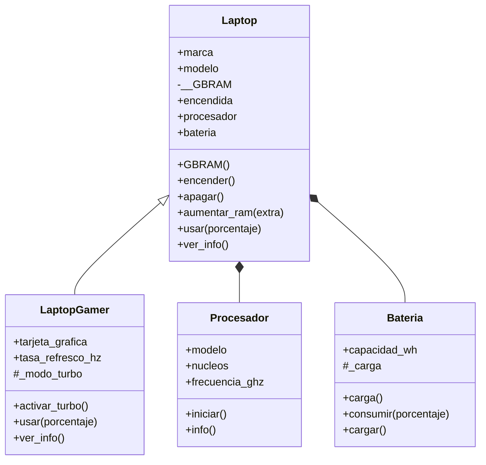

# Sistema de inventario tecnológico (POO en Python)

Avance 3 Final: Composición y Módulos.

- `modelos.py`: clases `Procesador`, `Bateria`, `Laptop` y `LaptopGamer`.
- `main.py`: instanciación de objetos y pruebas.
- `assets/diagrama_uml.png`: diagrama UML.

Ejecutar: `python main.py`

## Diagrama UML

